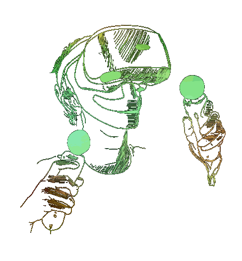

<table>
<tr>
<td width="42%" valign="middle" align="center">

</td>
<td valign="middle">

<h1><code>Hi! I'm AC</code></h1>

 

</td>
</tr>
</table>

---

## what drives me

I'm a third-year CS student who got into tech through making things: machinimas as a kid, a film festival runner-up finish in high school, then VR, where I could finally stand inside a scene instead of clicking keyframes.

The thread through everything I build is the same. I find the thing that stops someone from creating, playing or showing up, and I try to build the tool that gets it out of the way.

| the barrier | what I did about it |
|---|---|
| Filming a multi-character scene takes a crew and a mocap suit | **Chimeral Theater**: a one-person VR film set where the headset is the mocap |
| Unity can't save custom data at runtime | **UniRes**: Godot-style runtime save/load for Unity |
| Reordering a game's workshop content means hand-editing config files | **ROA-WCM**: a drag-and-drop desktop app |
| Fitting a VR headset starts with a measurement most people can't take | **OpenIPD**: measure your IPD with a webcam and an ID-sized card |
| Running in VR games usually needs expensive locomotion gear | A magnetic sensor on a cheap treadmill, wired into an input system |
| Walking into an unfamiliar event alone is intimidating | **CommonRoom**: a campus-events app that shows who's going, built at a hackathon |
| Newcomer students arrive without the language or community yet | Peer leader, then mentor, in an orientation program, pairing English learners with peers who share their language |
| "Competitive" clubs can feel closed to everyone else | Created the **Casual Corner** at Sheridan Fight Club |

---

## toolbox

---

## how I work

- I design the data models and file formats first, then research the engine's limits and build whatever's missing.
- I use AI coding assistants for syntax, debugging and implementation, after I've settled the architecture, and I review everything they produce.
- On a team, I like making the plan visible: UML diagrams, mockups, and questioning design decisions until everyone agrees.

## say hi

I'm happy to talk about interactive tech, creative tools, VR, or co-op opportunities. The easiest way to reach me is [Email](veisi@sheridancollege.ca).
